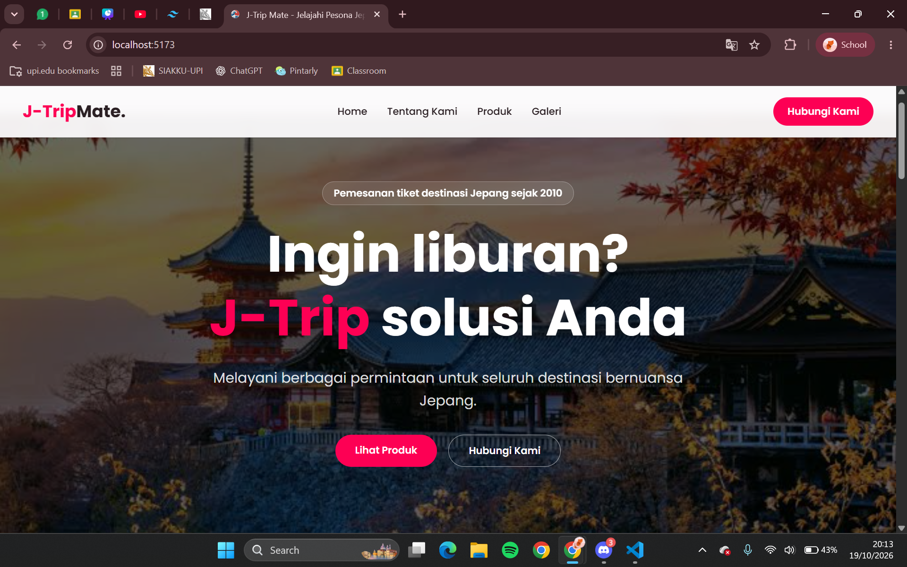
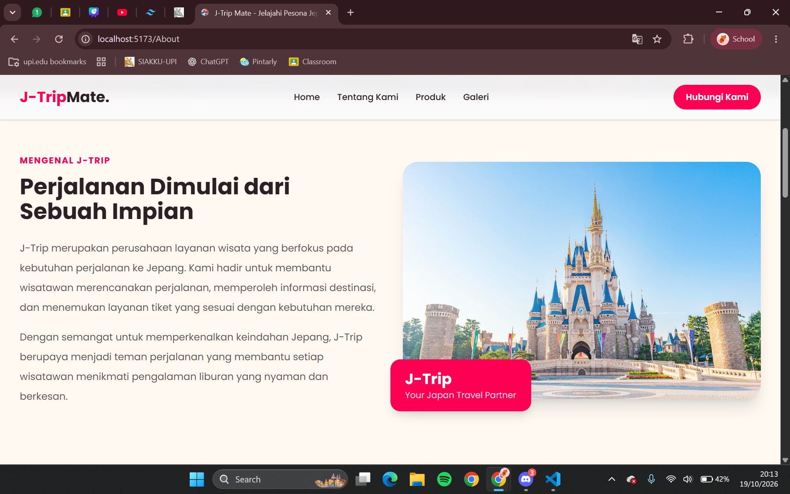
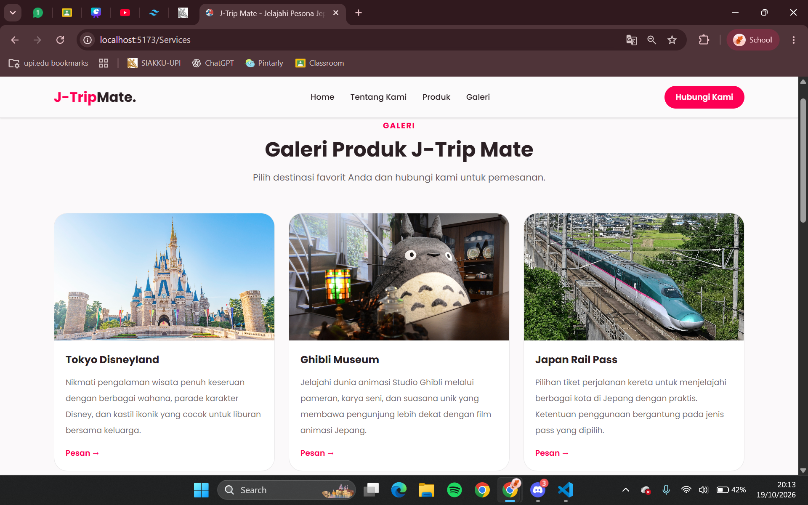
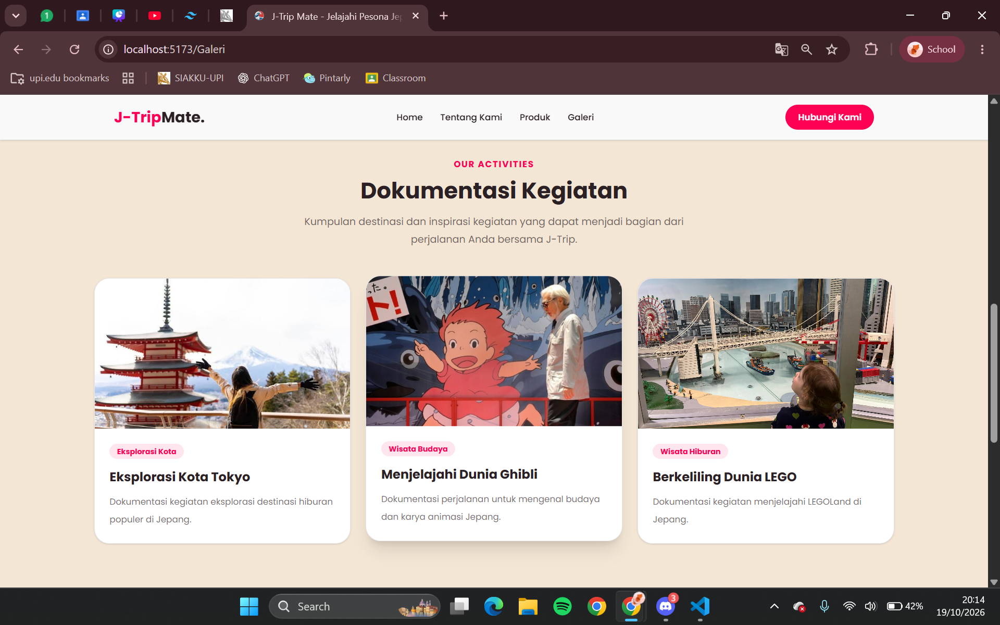
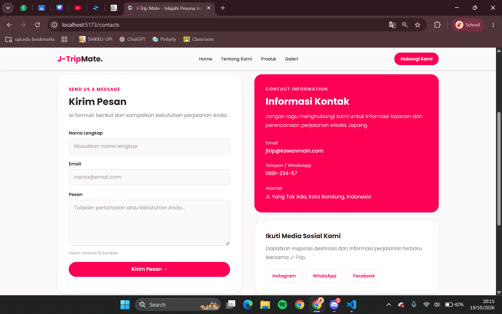
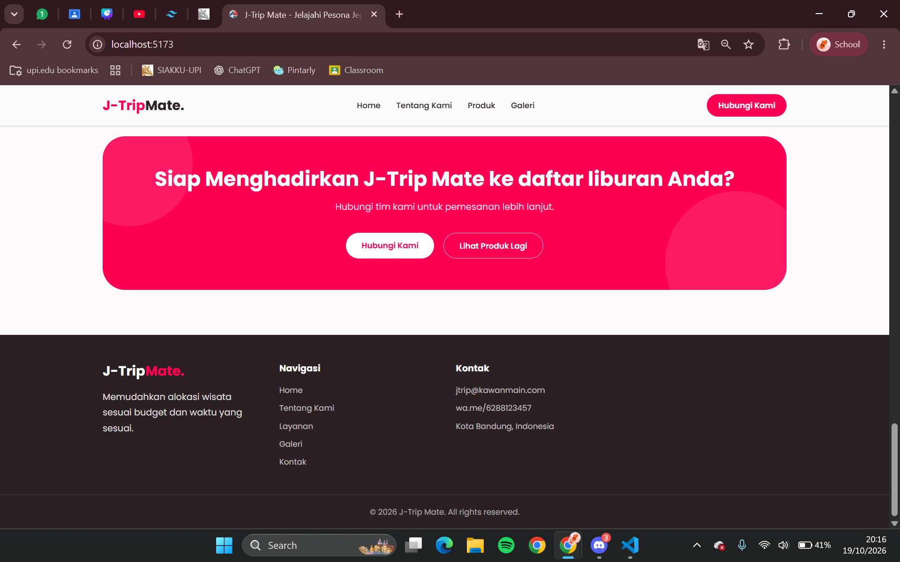

# J-TRIP MATE

## IDENTITAS
Nama    : Khansa Lathifah Audrya
NIM     : 2505579
Kelas   : PILKOM - 3C

## DESKRIPSI WEBSITE
J-TripMate merupakan website yang bergerak di bidang pariwisata, berisi tentang kumpulan destinasi wisata transportasi yang ada di Jepang 

Isi dari website berupa kumpulan destinasi wisata populer di Jepang hingga kereta yang biasa digunakan, seperti Shinkansen dan Hokuriku Arch Pass. Selain itu, terdapat fitur untuk memesan tiket destinasi dan kereta yang nantinya akan dihubungkan langsung ke contact person admin.

## FITUR YANG DIINSTAL
- Tailwind CSS IntelliSense
- React Router Dom

## CARA MENJALANKAN PROJECT
1. Jika file belum tersedia pada explorer, download terlebih dahulu lalu ekstral zip nya
2. Buka file pada vscode
3. Instal tailwind (jika belum) dengan sintaks npm install tailwindcss @tailwind/vite
4. Instal react-router-dom dengan sintaks npm install react-router-dom
5. Jalankan website dengan sintaks "npm run dev" lalu buka http://localhost:5173/
6. Jika ingin distop tekan CTRL + C

## SCREENSHOT HALAMAN

### Home

### About

### Services

### Galeri

### Contact

### Navbar dan Footer

